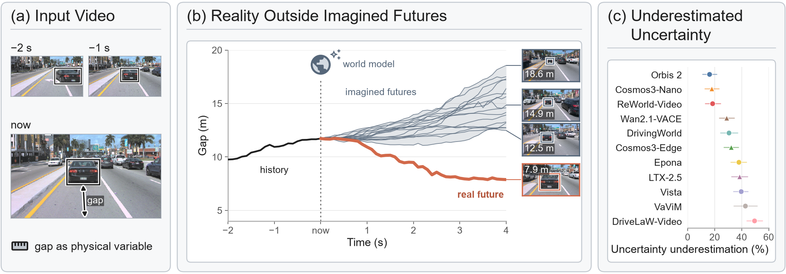
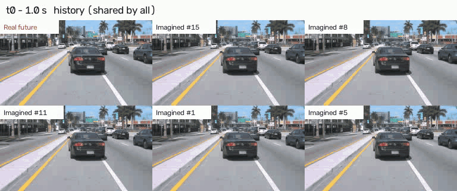
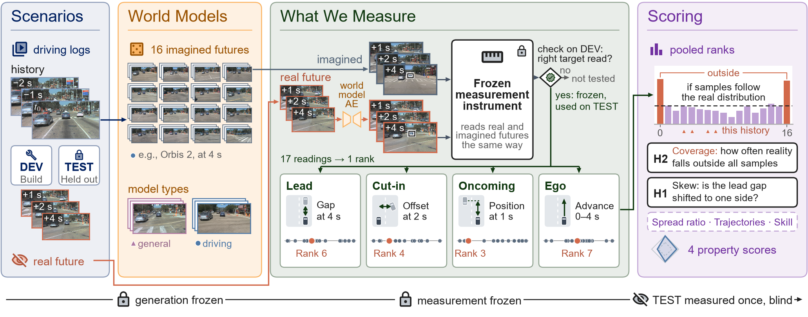
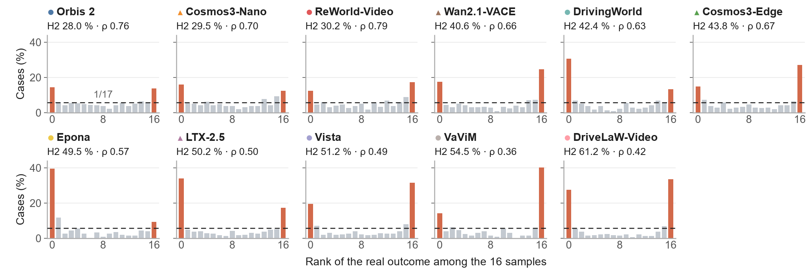

<div align="center">

# DriveOddsBench: Are Driving Video World Models Aligned with Real-World Odds?

Jiaxi Liu · Keshu Wu · Bin Ran · Xiaopeng Li<sup>*</sup>

Department of Civil and Environmental Engineering, University of Wisconsin–Madison · <sup>*</sup>Corresponding author

[Project page](https://hhjj233.github.io/DriveOddsBench-page/) · [Paper (arXiv)](https://arxiv.org/abs/2611.29275)



<em>Driving video world models underestimate their uncertainty. (a) A test history from Argoverse 2. (b) The lead vehicle braked, and none of the futures that Orbis 2 imagines did. (c) For every model, the real outcome falls outside all samples far more often than the 11.8 % expected when the samples follow the real distribution.</em>

</div>

## 📢 Status

- **2026-11** — Code released: the history selection, the frozen measurement instrument and analysis, the generation kits and sample specs of the eleven tested models, and the DEV and TEST splits.

## 🚧 Release TODO

- [x] History selection and scenario families, past information only (`scripts/make_benchmark_windows.py`, `scripts/count_scenario_families.py`)
- [x] Frozen measurement instrument and its configuration (`scripts/`, `instrument_config/`), with the hashes of the frozen files ([`FROZEN_MANIFEST.md`](FROZEN_MANIFEST.md))
- [x] Frozen confirmatory analysis (H2, H1), secondary quantities, and the frozen whole-trajectory analysis with its analysis plans
- [x] Continuation breaks at t0, property scores, spread ratio, the export of the numbers behind the figures, and the scalar validation of the rank test
- [x] Generation kits of nine models (`generation/`), the sample specs and runners of Cosmos3-Nano and Cosmos3-Edge (`scripts/make_bench_nano_specs.py`, `scripts/make_bench_edge_specs.py`, `scripts/run_cosmos3_calibration.py`, `scripts/edge/run_cosmos3_calibration.py`), and the settings of all eleven ([`IMPLEMENTATION.md`](IMPLEMENTATION.md#4-generation))
- [x] DEV (60) and TEST (200) history lists with their scenario families (`data/`)
- [ ] Released records: one record per reading (history, model, sample, quantity, horizon, value, validity), on Hugging Face
- [ ] The 35,200 generated test futures
- [ ] The frozen protocols and their amendments, edited for release
- [ ] Generation kits without the cluster-specific launchers (`run_*chunks*.sh`, queue settings)

## ✨ Key Idea

> **TL;DR.** Video world models are used in place of the real future, so their samples should be *aligned with real-world odds*: each future should appear among the samples as often as it follows the same history in reality. A recorded driving history has only one real future, but under alignment the rank of the real outcome among K samples is uniform in every history. Pooling these ranks over many histories tests alignment without knowing any probability. DriveOddsBench applies this test to eleven driving and general video world models on Argoverse 2, with one frozen instrument that reads the same physical quantities from real and imagined futures.

<p align="center"></p>
<p align="center"><em>The test history of the teaser, from t0 − 1 s to t0 + 4 s. Top left: the real future (raw video, red frame), in which the lead vehicle brakes. The other panels: five of the sixteen futures that Orbis 2 imagines from the same history. Frames: Argoverse 2 (CC BY-NC-SA 4.0).</em></p>

- **One future is enough once histories are pooled.** If a model's conditional distribution of a measured quantity equals the real one, the real reading and the K = 16 samples are exchangeable, so the rank of the real reading is uniform on {0, …, 16} in every history, whatever the history's outcome distribution.
- **Coverage (H2).** Under alignment the real reading falls outside the range of all 16 samples in 2/17 = 11.8 % of cases. When it does so more often, the samples are more certain about the real outcome than the model's errors allow: the model underestimates its uncertainty. Too little spread and a shift both cause this.
- **Skew (H1).** A skewed model places its samples to one side of reality; H1 tests the mean PIT of the lead gap at 4 s.
- **Spread ratio.** ρ = E|X − X′| / E|X − Y| is 1 under alignment for any number of samples; ρ < 1 means that the samples lie closer to one another than to reality.

## 🧠 Method Overview

<p align="center"></p>
<p align="center"><em>Each model continues held-out Argoverse 2 histories with 16 futures. One frozen instrument, checked on DEV, reads the same quantities from every imagined future and from the real future after the world model's autoencoder. Ranks pooled over histories give the two pre-registered tests.</em></p>

| Stage | What it does | Where |
|---|---|---|
| Histories | 2 s front-camera histories and their 6 s real futures from the AV2 Sensor dataset; five scenario families assigned from annotations and poses up to t0 only | `scripts/make_benchmark_windows.py`, `scripts/count_scenario_families.py`, `data/` |
| Generation | 16 futures per history and model, with each model's released settings and one seed per sample | `generation/<model>/`, `scripts/make_bench_nano_specs.py`, `scripts/make_bench_edge_specs.py` |
| Instrument | Per-frame detections, three trackers with a median ensemble, ground-contact distance under a flat road, band visual odometry for the ego motion; reliability labels fixed on DEV | `scripts/detect_bench_v2.py`, `scripts/measure_bench_v2.py`, `scripts/measure_bench_ego_vo.py`, `scripts/canvas_instrument/`, `instrument_config/` |
| Analysis | Ranks with random tie-breaking, H2 with a permutation null, H1, Holm; secondary quantities with Benjamini–Hochberg; whole trajectories; skill, property scores, spread ratio | `scripts/analyze_bench_v1.py`, `scripts/bench_holm_two_sided.py`, `scripts/analyze_bench_v12.py`, `scripts/trajectory-calibration-v1*/`, `scripts/make_overview_figures.py`, `scripts/spread_ratio.py` |

[`IMPLEMENTATION.md`](IMPLEMENTATION.md) describes every step in detail, and [`CODEMAP.md`](CODEMAP.md) maps each section of the paper to the code.

## 📊 Results

TEST results, as in Table 3 of the paper: 200 held-out histories, K = 16 samples per history, 35,200 generated futures. Sorted by the outside rate (H2). Bold H1: confirmed skew (Holm, with the bootstrap interval on the same side).

| Model | Type | Outside all 16 samples (%)<br>(11.8 if aligned) | Spread ratio ρ<br>(1 if aligned) | Lead-gap skew,<br>mean PIT − ½ (0 if aligned) | CRPS skill vs.<br>climatology (%) ↑ |
|---|---|---:|---:|---:|---:|
| Orbis 2 | driving | 28.0 | 0.76 | +0.056 | 56 |
| Cosmos3-Nano | general | 29.5 | 0.70 | −0.008 | 45 |
| ReWorld-Video | driving | 30.2 | 0.79 | +0.051 | 37 |
| Wan2.1-VACE | general | 40.6 | 0.66 | **+0.177** | 34 |
| DrivingWorld | driving | 42.4 | 0.63 | **−0.169** | 18 |
| Cosmos3-Edge | general | 43.8 | 0.67 | −0.066 | 6 |
| Epona | driving | 49.5 | 0.57 | **−0.238** | 26 |
| LTX-2.5 | general | 50.2 | 0.50 | −0.039 | 30 |
| Vista | driving | 51.2 | 0.49 | **+0.120** | −17 |
| VaViM | driving | 54.5 | 0.36 | **+0.249** | −30 |
| DriveLaW-Video | driving | 61.2 | 0.42 | +0.072 | 12 |

- **None is aligned, and every model underestimates its uncertainty.** H2 is confirmed for all eleven models: the real outcome falls outside all 16 samples in 28–61 % of cases, 2.4 to 5.2 times the 11.8 % expected, and every spread ratio and its 95 % interval lie below 1.
- **Five models are skewed, in opposite directions.** Epona and DrivingWorld place the lead vehicle too far ahead, and VaViM, Wan2.1-VACE and Vista too close. The largest skew is in the ego motion.
- **Informative samples can still miss the real distribution.** Nine models beat climatology, yet none follows the real distribution.

<p align="center"></p>
<p align="center"><em>Rank histograms pooled over the primary quantities (Fig. 5 of the paper). Dashed: 1/17, the value under alignment. Terracotta: ranks 0 and 16, where the real outcome lies outside all samples.</em></p>

## 🚀 Getting Started

```bash
git clone <this repository> DriveOddsBench && cd DriveOddsBench
python -m venv .venv && source .venv/bin/activate
pip install -r requirements.txt
export DOB_ROOT=/path/to/workdir   # holds datasets/, outputs/, cache/ and checkpoints/
```

**Data.** Download the [Argoverse 2 Sensor dataset](https://www.argoverse.org/av2.html) to `$DOB_ROOT/datasets/av2_sensor`. The DEV and TEST histories and their scenario families are listed in `data/`.

**Check the statistics** (CPU, a few minutes): the scalar validation of the rank test, on simulated numbers with known answers (App. F). It writes `data/statistical_validation.json`, `data/statistical_validation.csv` and `tables/statistical_validation.tex`.

```bash
python scripts/validate_rank_test.py
```

**Evaluate a model.** Each step is a script under `scripts/` or `generation/`; [`IMPLEMENTATION.md`](IMPLEMENTATION.md#9-running-the-pipeline) gives the full sequence of commands.

1. Render each history onto the 512 × 288 measurement canvas (`scripts/make_benchmark_windows.py`) and build the model's inputs (`generation/<model>/build_*.py`).
2. Generate 16 futures per history, and the real reference through the model's autoencoder (`generation/<model>/`; for Cosmos3, the specs of `scripts/make_bench_nano_specs.py` and `scripts/make_bench_edge_specs.py`, run by `scripts/run_cosmos3_calibration.py` and `scripts/edge/run_cosmos3_calibration.py`).
3. Detect objects on every frame (`scripts/detect_bench_v2.py`, or `scripts/canvas_instrument/detect_canvas.py` for a model's own canvas).
4. Read the quantities, the ego motion and the secondary quantities (`scripts/measure_bench_v2.py`, `scripts/measure_bench_ego_vo.py` and `scripts/derive_bench_quantities.py`, or their counterparts for a model's own canvas in `scripts/canvas_instrument/`).
5. Fix the reliability labels on DEV (`scripts/rules_bench_v2.py` or `scripts/canvas_instrument/rules_canvas.py`), then run the frozen analysis (`scripts/analyze_bench_v1.py`, then `scripts/bench_holm_two_sided.py`), the secondary panel (`scripts/analyze_bench_v12.py`) and the whole trajectories (`scripts/trajectory-calibration-v1*/`).
6. Summarize: continuation breaks (`scripts/continuation_break.py`; VaViM on its 2 Hz grid with `scripts/continuation_break_2hz.py`), property scores (`scripts/make_overview_figures.py`), the numbers behind the figures (`scripts/export_supply.py`) and the spread ratio (`scripts/spread_ratio.py`).

## 📁 Repository Structure

```text
DriveOddsBench/
├── scripts/              # history selection, instrument, analysis (frozen files listed in FROZEN_MANIFEST.md)
│   ├── canvas_instrument/  # the same instrument on each model's own canvas and frame rate, band odometry
│   └── trajectory-calibration-v1*/  # frozen whole-trajectory analysis, its plans and freeze records
├── instrument_config/    # frozen instrument configuration and scorability rules
├── generation/           # one kit per model (Cosmos3: specs in scripts/): input builders, spec generators, runners, pinned versions
├── data/                 # DEV and TEST history lists, scenario families, the teaser case
├── docs/assets/          # figures and the visualization
├── IMPLEMENTATION.md     # how every step is implemented
├── CODEMAP.md            # paper section -> code
└── FROZEN_MANIFEST.md    # hashes of the frozen files and the differences of their copies here
```

## 📄 Paper

*DriveOddsBench: Are Driving Video World Models Aligned with Real-World Odds?* [arXiv:2611.29275](https://arxiv.org/abs/2611.29275). The project page has two short videos: the pipeline, and one test history worked through.

## 📚 Citation

```bibtex
@article{liu2026driveoddsbench,
  title   = {DriveOddsBench: Are Driving Video World Models Aligned with Real-World Odds?},
  author  = {Liu, Jiaxi and Wu, Keshu and Ran, Bin and Li, Xiaopeng},
  journal = {arXiv preprint arXiv:2611.29275},
  year    = {2026}
}
```

## 🙏 Acknowledgements

We build on the [Argoverse 2](https://www.argoverse.org/av2.html) Sensor dataset and evaluate Orbis 2, Cosmos3-Nano, Cosmos3-Edge, LTX-2.5, Wan2.1-VACE, Epona, DrivingWorld, ReWorld-Video, DriveLaW-Video, VaViM and Vista with the weights and code released by their authors. The instrument uses torchvision's COCO Faster R-CNN and RAFT. See [`THIRD_PARTY_NOTICES.md`](THIRD_PARTY_NOTICES.md).

## 📜 License

Code: [MIT](LICENSE). Data, model weights and third-party components keep their own licenses ([`THIRD_PARTY_NOTICES.md`](THIRD_PARTY_NOTICES.md)).
